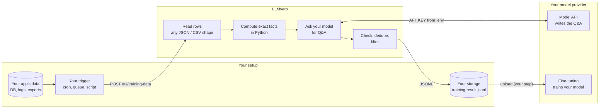

# LLMvero

**Turn your app's raw data into training and evaluation data with exact answers, using your own model.**

LLMvero is a small self-hosted backend (Python + FastAPI). You send it data from your app, for example a day of
logins (`user_id` + `date_time`). It works out the facts exactly, asks your model (Anthropic, OpenAI, Gemini or a
local one) to turn them into questions and answers, checks that every number in every answer is right, and
returns JSONL you can use to:

- **fine-tune a model to use your data**: it learns to call your functions (`get_activity_summary`,
  `get_user_activity`...) and answer from live numbers, e.g. "what's our peak login time?" or "who logs in the
  most?";
- **test an AI assistant**: every question comes with its exact expected answer;
- **fine-tune on plain Q&A**, for a model that should know a fixed history.

LLMvero is only the core. How you export your data, when you call it, where you store the output and how you
fine-tune stay in your own setup.

## Where LLMvero fits



| Your side | LLMvero | Model provider |
|---|---|---|
| Export the data from your app (database, logs) | Read it in any common shape and find the user and time fields | Write questions and answers from the facts LLMvero gives it |
| Decide when to call LLMvero (every night, on demand...) | Compute the stats exactly (peak hour, top users, habits...) | Fine-tune a model on the JSONL you upload |
| Store the JSONL it returns | Call your model, check every example, drop wrong or duplicate ones | Serve the trained model to your app |
| Upload it for fine-tuning and use the trained model | Return training data in the format your provider expects | |

**Why the facts are computed in Python:** language models can't count hundreds of rows reliably. If the model
counted, your training data would teach wrong numbers. LLMvero does the counting, and the model only writes the
numbers it is given as natural questions and answers.

## Which approach should I use?

Fine-tuning teaches a model **behaviour** (tone, format, which question needs which data) well, and **facts**
poorly: a model trained on "the peak was 09:00 with 21 logins" can still answer 22, mix up days, and knows
nothing about days after its training. So pick the output for your goal:

| Your goal | Use | What the model learns |
|---|---|---|
| An assistant that answers about live data | `?style=tool_calls` ([guide](docs/tool-calling.md)) | To call your functions and answer from their results. Numbers come fresh from your database, so it's right for any day without retraining |
| Test an assistant or agent you already have | `?format=eval` | Nothing: you get test cases with question, expected answer (and expected function call) and the facts |
| A model that knows a fixed history (archive, report) | default (`style=qa`) | The facts themselves. Fine for data that doesn't change; retrain when it does |

For most apps the first row is the right one: fine-tune with `style=tool_calls` so the model knows *how* to get
the numbers, and let your functions supply them.

## Quick start

**1. Install and start the server** (Python 3.10+). `PROVIDER=mock` is a free fake model for testing, so no key
is needed yet.

```bash
python -m venv .venv && source .venv/bin/activate
pip install -e .
PROVIDER=mock llmvero serve --port 8000
```

**2. Send a day of logins** (in a second terminal). [`examples/login.json`](examples/login.json) has 145 rows
like `{"user_id": 7, "date_time": "2026-11-06 09:12:44"}`.

```bash
curl --data-binary @examples/login.json http://localhost:8000/v1/training-data
```

**3. Use your real model.** Copy `.env.example` to `.env` and fill it in:

```bash
PROVIDER=openai      # anthropic, openai, gemini, openai_compatible or mock
MODEL=               # empty = the provider's default model
API_KEY=sk-...
```

Restart with `llmvero serve --port 8000` and save the training data to a file:

```bash
curl -s --data-binary @examples/login.json "http://localhost:8000/v1/training-data?output=jsonl" > training-result.jsonl
```

With OpenAI this takes about 10 seconds and returns around 55 examples. For the recommended setup, where the
trained model looks numbers up instead of memorizing them, add `style=tool_calls`:

```bash
curl -s --data-binary @examples/login.json "http://localhost:8000/v1/training-data?style=tool_calls&output=jsonl" > training-result.jsonl
```

## Input: what you send

`POST /v1/training-data` with your data file as the request body, unchanged. Each row is one event: who did it and when.

Accepted shapes:

- a JSON list: `[{"user_id": 1, "date_time": "2026-11-06 09:12:44"}, ...]`
- an object holding the list: `{"logins": [...]}` (the key also names the event: "logins" → "login")
- JSON Lines (one object per line) or CSV (comma, semicolon or tab)
- nested fields: `{"user": {"id": 1}, "created_at": "..."}`

LLMvero finds the fields itself:

| Field | Names it recognises |
|---|---|
| Who | `user_id`, `userId`, `uid`, `username`, `email`, `account_id`, `member_id`, `customer_id`, `user.id`... |
| When | `date_time`, `datetime`, `timestamp`, `time`, `created_at`, `logged_in_at`, `login_time`, `date`, `ts`... |

Times can be `2026-11-06 09:12:44`, ISO 8601 (`2026-11-06T09:12:44Z`) or Unix timestamps. Times are used as
written; LLMvero doesn't convert time zones. Other fields in a row are ignored.

If your names are different, the error lists your fields; name them in the URL:
`?user_field=member&time_field=signed_in`.

**What fits:** any "who did something, and when" events: logins, orders, page views, check-ins, support tickets
opened. **What doesn't:** data without a user and a time. For text (articles, docs, chat logs), use text mode
instead: see [docs/advanced.md](docs/advanced.md).

## Output: what you get back

By default a JSON object:

| Field | What it is |
|---|---|
| `examples` | The training data: one question and answer per item (with the function call, for `style=tool_calls`) |
| `facts` | The stats LLMvero computed, so you can check them (overview, per hour, top users, per day, user habits) |
| `rejected` | How many examples were dropped and why, e.g. `{"duplicate": 2, "not_about_one_user": 1}` |
| `input_tokens`, `output_tokens` | What the model calls used, for cost tracking |
| `errors` | Model calls that failed, if any (the rest still return) |
| `tools` | With `style=tool_calls`: the function definitions the trained model will call |

With `?output=jsonl` you get only the training data, one example per line, ready to save:

```json
{"messages": [{"role": "user", "content": "What was the peak login hour on November 6, 2026?"}, {"role": "assistant", "content": "The peak hour was 09:00–09:59, with 21 logins by 17 different users."}]}
{"messages": [{"role": "user", "content": "When did user 23 last log in on 2026-11-06?"}, {"role": "assistant", "content": "User 23 last logged in at 16:46."}]}
```

What one run covers:

- **The whole period:** total events and users, peak hour, next busiest hours, busiest 15 minutes, quiet hours,
  first and last event, morning / afternoon / evening / night split, most active users, users seen only once.
- **Each day,** when the file spans several days: busiest and quietest day, average per day.
- **Each user** (up to the 50 most active): count, first and last time, usual hour (only when there is a clear
  one), parts of the day they're active.

Every example is checked before it is returned: every number and time in the answer must appear in the facts it
came from (so the model can't add things up or guess), questions about one user must name exactly one user from
that user's fact sheet, duplicates are dropped, and malformed or refused answers are removed.

### URL options

| Option | Default | |
|---|---|---|
| `output` | `json` | `jsonl` returns only the training data lines |
| `style` | `qa` | `tool_calls`: the assistant calls a function to get the numbers, then answers ([guide](docs/tool-calling.md)) |
| `format` | `openai` | `eval` (test cases), `anthropic`, `gemini`, `sharegpt`, `alpaca`, `raw` (see [formats](docs/advanced.md#export-formats)) |
| `examples_per_chunk` | `5` | Examples written per summary fact sheet |
| `event` | guessed | What one row is (`login`, `order`, `page view`...), used in the wording |
| `user_field`, `time_field` | detected | Field names, when detection can't tell |
| `system_prompt` | `SYSTEM_PROMPT` in `.env`, else none | System message stored in every example: the persona of the model you'll train |
| `provider`, `model` | from `.env` | Use a different model for this call |
| `quality_check` | `false` | A second model call scores each example and drops weak ones (about double the cost) |

### Errors

| Status | Meaning |
|---|---|
| `401` | `ACCESS_KEY` is set and the call didn't send `Authorization: Bearer <key>` |
| `400` | The provider isn't configured: check `PROVIDER` and `API_KEY` in `.env` |
| `422` | The file can't be read, or the user or time field can't be found. The message lists your fields |
| `413` | The file is larger than 100 MB |
| `502` | Every model call failed. `errors` has the provider's messages (wrong key, wrong model name...) |

## Your setup

### Calling it from your app

Anything that can send an HTTP request works. Call it from your backend, not a browser, so `ACCESS_KEY` stays
private.

```js
// Node.js / Next.js route handler
const res = await fetch("http://localhost:8000/v1/training-data?output=jsonl", {
  method: "POST",
  headers: { authorization: `Bearer ${process.env.LLMVERO_ACCESS_KEY}` }, // only if ACCESS_KEY is set
  body: JSON.stringify(todaysLogins), // [{ user_id, date_time }, ...] straight from your database
});
const trainingData = await res.text(); // JSONL: append it to your file or storage
```

```python
# Python
import requests

res = requests.post("http://localhost:8000/v1/training-data", params={"output": "jsonl"}, json=todays_logins)
open("training-result.jsonl", "a").write(res.text)
```

### Running it every day

LLMvero has no scheduler: your setup decides when to call it. For example a cron job at 8pm sends that day's
export and appends the result (`>>`) to one growing training file:

```bash
0 20 * * * curl -s --data-binary @/exports/logins-$(date +\%F).json "http://localhost:8000/v1/training-data?output=jsonl" >> /data/training-result.jsonl
```

Each run is independent and dated, so the file builds up a history ("on November 6...", "on November 7...").

### Fine-tuning on the output

LLMvero creates the training data; the training itself happens at your provider. With OpenAI:

```bash
# 1. Upload the file
curl https://api.openai.com/v1/files -H "Authorization: Bearer $OPENAI_API_KEY" \
  -F purpose=fine-tune -F file=@training-result.jsonl

# 2. Start a fine-tuning job with the file id from step 1
curl https://api.openai.com/v1/fine_tuning/jobs -H "Authorization: Bearer $OPENAI_API_KEY" \
  -H "Content-Type: application/json" \
  -d '{"training_file": "file-...", "model": "<a model OpenAI allows fine-tuning>"}'
```

For other platforms, ask for their format with `?format=`: `anthropic` (Claude on Amazon Bedrock), `gemini`
(Vertex AI), `sharegpt` (Axolotl, LLaMA-Factory, Unsloth for open-source models).

Keep in mind:

- With the default `style=qa`, a fine-tuned model only knows the days it was trained on, and may misremember
  numbers. For answers about current data, use `style=tool_calls` instead: see
  [Which approach should I use?](#which-approach-should-i-use).
- Keep the training file private: it contains your users' activity. `training-result*.jsonl` is in `.gitignore`.

### Cost

LLMvero sends the model the computed facts, not your raw rows, so the cost barely grows with file size: at most
50 user profiles are sent, however many users you have. The sample day (145 logins) uses about 5,500 input and
3,500 output tokens, roughly 2 cents with `gpt-6.1-terra`. `quality_check=true` roughly doubles it.

## Configuration

`.env` needs only `PROVIDER` and `API_KEY` (plus `MODEL` if you don't want the default).

| `PROVIDER` | Default `MODEL` | Notes |
|---|---|---|
| `anthropic` | `claude-sonnet-5-5` | Claude through the Messages API |
| `openai` | `gpt-6.1-terra` | `gpt-6-luna` is cheaper for big daily files |
| `gemini` | `gemini-2.5-flash` | Google AI Studio key |
| `openai_compatible` | none, set `MODEL` | Ollama, vLLM, LM Studio, Groq, OpenRouter, DeepSeek... Also set `BASE_URL` (Ollama: `http://localhost:11434/v1`, no key) |
| `mock` | `mock-1` | Free fake model for testing. No key |

Optional settings:

| Variable | Default | |
|---|---|---|
| `ACCESS_KEY` | empty | Protects LLMvero: callers must send `Authorization: Bearer <key>`. Set it on any shared server |
| `SYSTEM_PROMPT` | empty | System message stored in every example |
| `BASE_URL` | provider default | For `openai_compatible` or a custom endpoint |
| `LLMVERO_MAX_CONCURRENCY` | `4` | Model calls running at the same time. Lower it if you hit rate limits |
| `LLMVERO_DATA_DIR` | `./data` | Where the SQLite file for datasets and jobs lives |

Rate limits, overloads and network errors are retried automatically with backoff.

### Docker

```bash
cp .env.example .env    # fill in PROVIDER and API_KEY
docker compose up -d
curl --data-binary @examples/login.json http://localhost:8000/v1/training-data
```

## Privacy and security

- Your raw rows never leave the server: only the computed facts (user ids, counts, times) go to the model
  provider you chose. Use `openai_compatible` with Ollama or vLLM to keep everything on your own machines.
- Keys are read from `.env` and never returned by the API or stored.
- Set `ACCESS_KEY` and put LLMvero behind HTTPS (Caddy, Nginx, a load balancer) when it runs on a shared or public
  server.
- You are responsible for having the right to use your data for training and for following your provider's terms.

## Learn more

- [docs/tool-calling.md](docs/tool-calling.md): the functions a `style=tool_calls` model calls, what they return,
  example SQL, and how to use the fine-tuned model
- [docs/architecture.md](docs/architecture.md): how the pieces fit, with diagrams of the records flow
- [docs/advanced.md](docs/advanced.md): text mode (articles, docs, chats), datasets and background jobs, task
  types, quality checks, export formats, webhooks
- `http://localhost:8000/docs`: every endpoint, generated by FastAPI

## Development

```bash
pip install -e ".[dev]"
pytest                                   # no API keys needed
ruff check . && ruff format --check .
```

```
llmvero/
├── main.py            app setup
├── api/routes.py      HTTP endpoints
├── core/
│   ├── records.py     read rows, detect fields, compute the fact sheets
│   ├── prompts.py     what the model is asked
│   ├── parsing.py     read the model's JSON reply
│   ├── quality.py     checks, de-duplication, PII masking
│   ├── pipeline.py    generation per fact sheet / chunk, background jobs
│   ├── chunking.py    split long text (text mode)
│   └── exporters.py   output formats
├── providers/         anthropic, openai (+ compatible), gemini, mock
└── db.py              SQLite store (datasets and jobs)
```

Adding a provider means one class with a `complete()` method in `llmvero/providers/` and one line in the
registry. Pull requests are welcome.

## License

[MIT](LICENSE)
