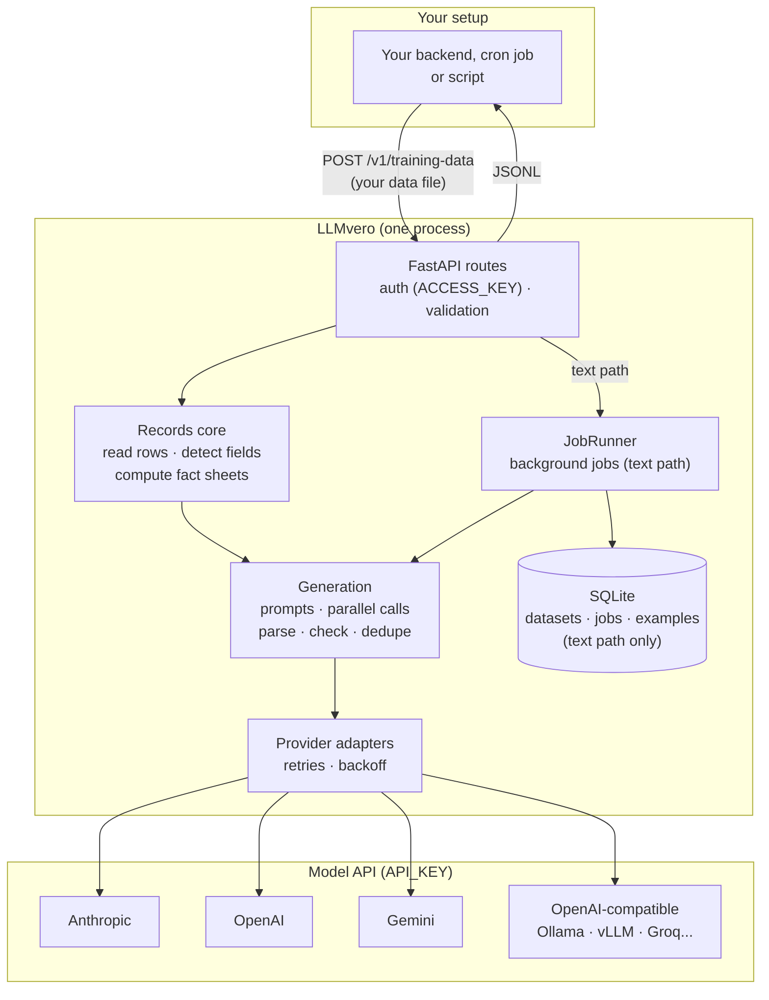
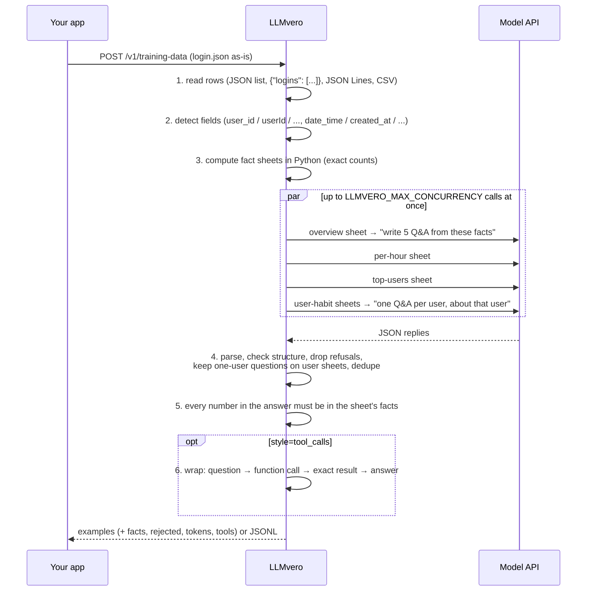
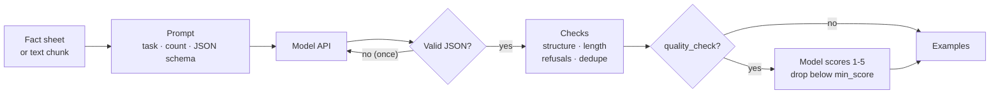
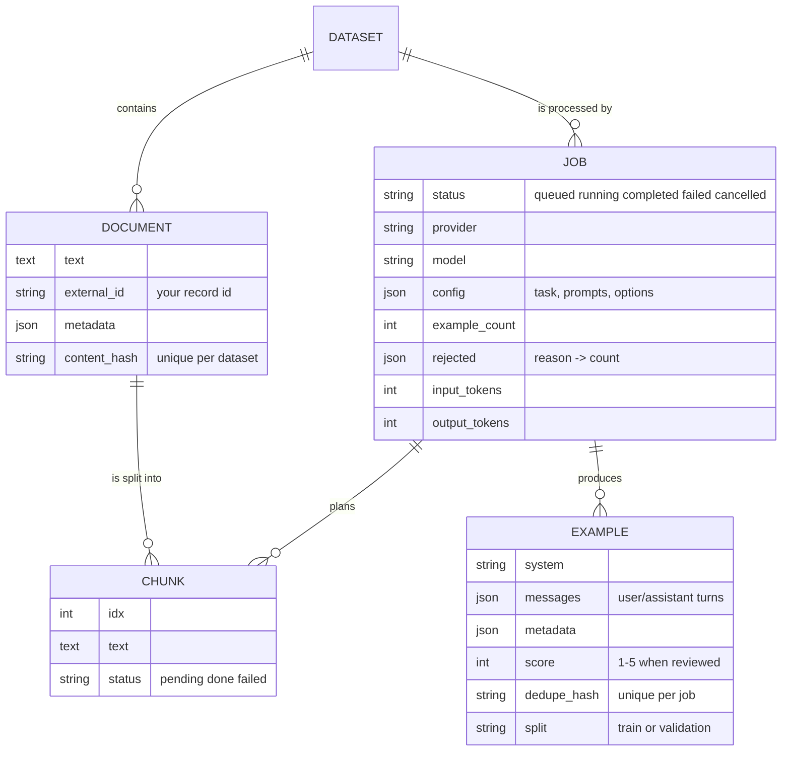
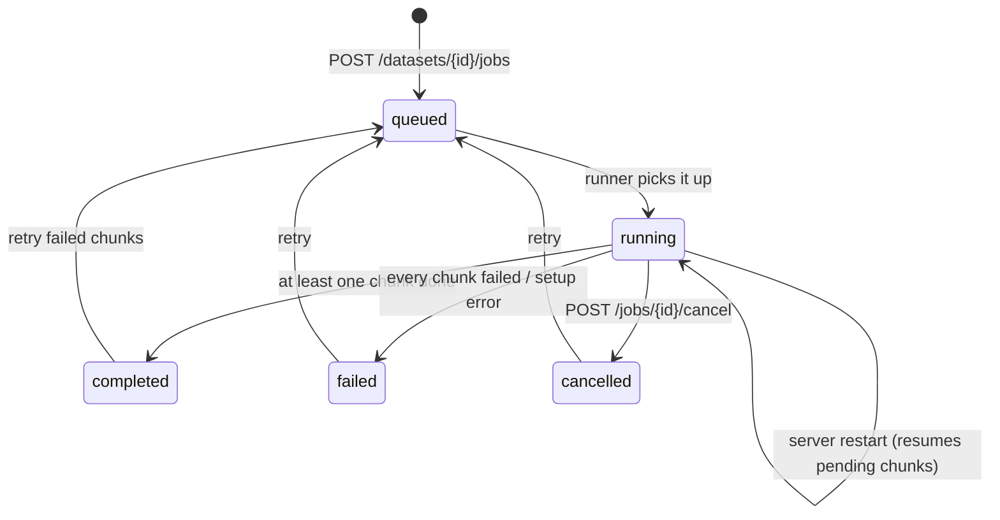
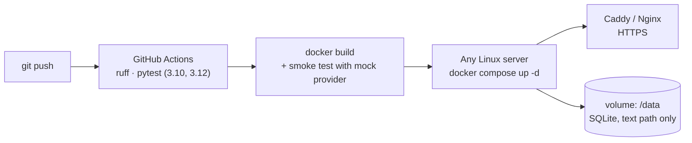

# Architecture

LLMvero is one Python process: a FastAPI app, provider adapters for the model APIs, and a SQLite file. There's no
queue, no Redis and no separate worker, so it self-hosts on a single small server.

It has two paths:

| Path | Endpoint | Input | State | Used for |
|---|---|---|---|---|
| **Records** (main) | `POST /v1/training-data` | Event rows: who + when | None: one request in, training data out | Daily runs on logins, orders, page views... |
| **Text** | `POST /v1/generate`, datasets + jobs | Documents: articles, docs, chats | Jobs saved in SQLite, resumable | Turning written content into training data |

## System overview

## Records flow

This is the path for the README's login example. Nothing is stored: the request carries the data in, the
response carries the training data out.

### Fact sheets

The rows are never sent to the model. LLMvero computes these sheets and sends them instead:

| Sheet | Contents | Examples asked for |
|---|---|---|
| `overview` | Totals, unique users, peak hour, next busiest hours, busiest 15 minutes, quietest hours, hours with no events, first and last event, night / morning / afternoon / evening split | `examples_per_chunk` |
| `hourly` | Events and distinct users for each of the 24 hours | `examples_per_chunk` |
| `users` | Top 10 users with counts and share, users seen once | `examples_per_chunk` |
| `daily` | Only when the file spans several days: events per day, busiest and quietest day, daily average | `examples_per_chunk` |
| `user_profiles_N` | 10 users per sheet, up to 50 users: count, first and last time, usual hour (only if clear), parts of the day | one per user on the sheet |

Each sheet also exists as JSON, which is the tool result in `style=tool_calls` and the `facts` in `format=eval`:

| Sheet | Function (`style=tool_calls`) |
|---|---|
| `overview` | `get_activity_summary(date_from, date_to)` |
| `hourly` | `get_hourly_counts(date_from, date_to)` |
| `users` | `get_top_users(date_from, date_to)` |
| `daily` | `get_daily_counts(date_from, date_to)` |
| `user_profiles_N` | `get_user_activity(user_id, date_from, date_to)` |

Three design choices keep the training data correct:

1. **The model never counts.** Every number comes from Python; the model only phrases the given facts as
   questions and answers. Models asked to count hundreds of rows produce plausible but wrong numbers, and a
   fine-tuned model would learn them.
2. **Partial sheets can't answer whole-day questions.** A user-habits sheet lists only 10 of the users, so a
   model reading it might claim "the busiest hour was 15:00" from that subset. These sheets ask for exactly one
   question per user, and any example whose question doesn't name exactly one user from the sheet is dropped
   (`rejected.not_about_one_user`).
3. **Every number is checked.** After generation, every number and time in each answer must appear in the facts
   for that sheet (dates aside). An answer that adds numbers up or guesses is dropped
   (`rejected.number_not_in_facts`).

Because the sheets are capped (50 user profiles at most), a day with 100,000 logins costs about the same as a
day with 150.

## Generation and checks

Both paths share the same generation step for each fact sheet or text chunk:

## Provider adapters

Each adapter turns the same call, `complete(system, prompt, model, max_tokens, temperature, json_mode)`, into
one HTTP request and reads back the text and token usage. Retries live in the shared base class: 408, 409, 425,
429, 5xx and 529 responses and network errors are retried with exponential backoff, using `Retry-After` when the
API sends it. Client errors such as a wrong key fail at once with the provider's own message.

| Adapter | Endpoint | JSON output |
|---|---|---|
| Anthropic | `POST /v1/messages` | prompt + tolerant parser |
| OpenAI | `POST /chat/completions` | `response_format: json_object` |
| Gemini | `POST /models/{model}:generateContent` | `responseMimeType: application/json` |
| OpenAI-compatible | `POST {base}/chat/completions` | prompt + tolerant parser (servers vary) |
| Mock | none | built locally, for tests |

`PROVIDER`, `MODEL`, `API_KEY` and `BASE_URL` configure the main provider. Others can be enabled with their own
`<NAME>_API_KEY` for single calls (see [advanced settings](advanced.md#all-settings)).

## Text path: datasets and jobs

For large text inputs, documents are stored in a dataset and processed by the in-process `JobRunner`. Progress is
saved per chunk, so a restart resumes where it stopped.

A chunk that fails (bad key, model down after retries, unreadable JSON twice) is marked `failed`; the rest of the
job continues, and `POST /v1/jobs/{id}/retry` re-runs only the failed chunks. When a job ends, an optional
webhook is sent, signed with `LLMVERO_WEBHOOK_SECRET`.

## Deployment

The records path keeps no state, so you can run several copies behind a load balancer. For the text path, back up
the `/data` volume; to scale it beyond one process, the job runner is the piece to swap for a real queue.
